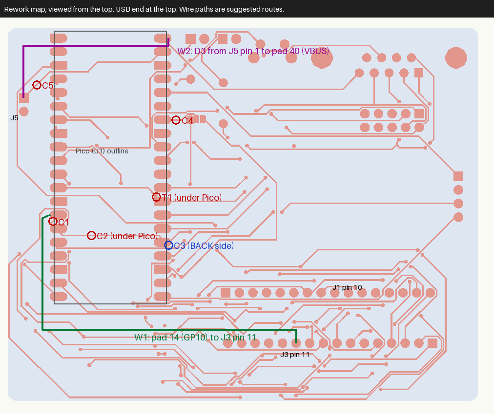

# Rework: boards from the Sep 18, 2026 Gerbers

> **Rev 1 boards only** (the v1.0 release). Rev 2 boards (v2.0 release, silkscreen
> "Rev 2 2026-11") have all of these faults fixed in copper. Don't cut or wire a
> Rev 2 board, and fit its LEDs **by** the silkscreen marking.

For boards made from `production/Coco_pico_keyb.zip`. The cuts and wires below were
tested in simulation against the Gerber copper and drill files, then built on one
physical board, whose keyboard works on a CoCo 3. Still do the meter checks at each
stage. A dead column on that build turned out to be an unsoldered connector pin, so
check connector joints first if a whole column is missing.

Do this on a **bare board, before fitting the Pico**. Cut C2 and trim T1 are under the
module. An assembled board needs its Pico removed first.

Coordinates are KiCad board millimetres, in `.kicad_pcb` coordinates.
"Pad n" is Pico pin n (U1).

## What's wrong

| # | Problem in the copper | Effect | Fix |
|---|---|---|---|
| 1 | GP10 track runs through pad 15 (GP11) | CoCo PB2 and PB3 tied together | C1, C2, W1 |
| 2 | GP10 via sits on pad 25 (GP19) | D1 LED output fights PB2 and PB3 | C2, C3, W1 |
| 3 | JP1 pad 1 (GP28) overlaps R1 pad 1 (GP19) | GP28 joined to the same group | C4 |
| 4 | GP9 via touches the corner of pad 28 (Pico GND) | CoCo PB1 grounded | T1 |
| 5 | D3 is in the schematic but not on the PCB; J5 goes straight to VSYS | USB power can backfeed the CoCo; a USB keyboard gets no 5 V from J5 | C5, D3, W2 |
| 6 | LED polarity is reversed on the schematic and PCB | LEDs don't light if fitted by the silkscreen | Fit reversed |

Faults 1 to 4 affect matrix columns PB1, PB2 and PB3, so they hit both firmware loads.

## 1. Check the board first

With a bare board, meter on continuity:

| Between | Expected before rework |
|---|---|
| Pads 14, 15, 25, 34 (any pair) | Beep |
| Pad 12 and pad 28 | Beep (see the note) |
| J5 pin 1 and pad 39 | Beep |

**Note:** the via and pad 28 only just touch, so this one could read either way on a
real board. If it's already open, skip T1.

If any other row doesn't match, stop. The board may not match these Gerbers.

## 2. Make the cuts

Trace width is 0.2 mm, so use magnification and a sharp blade. For each cut, make two
scores about 0.5 mm apart and lift out the copper between them.

| Cut | Side | Location | Where to find it |
|---|---|---|---|
| **C1** | Top | (87.85, 64.05) | Short diagonal leaving pad 14 toward pad 15. [Close-up](docs/rework/A_gp10_gp11_top.png) |
| **C2** | Top | (95.0, 66.67) | Horizontal run from below pad 15 across the Pico area |
| **C3** | **Back** | (109.40, 68.50) | Diagonal leaving the via on pad 25. [Close-up](docs/rework/C_back_cut.png), [via from the top](docs/rework/B_gp19_via_top.png) |
| **C4** | Top | (110.8, 45.10) | Track leaving pad 34 toward JP1. [Close-up](docs/rework/E_jp1_gp28.png) |
| **C5** | Top | (84.85, 38.55) | Diagonal leaving J5 pin 1. Don't hit the parallel track beside it. [Close-up](docs/rework/F_j5_vsys.png) |

**T1 (top):** trim the top-left corner of pad 28 back from the GP9 via at (107.0, 59.23)
until there's a clear gap. Remove pad copper only and leave the via ring intact.
[Close-up](docs/rework/D_gp9_pad28.png)

Don't bridge JP1 after this. It would ground GP19. C4 also disconnects GP28 from JP1,
and neither firmware uses GP28.

## 3. Add the wires

Use insulated wire such as 30 AWG, and tack it down.

- **W1:** pad 14 to J3 pin 11. Solder to the outer end of pad 14, which sticks out past
  the Pico. Stay clear of the far end of the Pico, because the antenna is there.
- **W2 + D3:** fit a 1 A Schottky diode (SS14 or 1N5817). Anode goes to J5 pin 1 and
  cathode goes by wire to the outer end of pad 40 (VBUS). Cross the USB end of the Pico
  and leave BOOTSEL and the USB plug clear.

W2 differs from the schematic, which has D3 feeding VSYS. Feeding VBUS still blocks
backfeed into the CoCo during a USB reflash, and it also gives a USB keyboard 5 V.
Expect about 4.6 V at the keyboard, depending on the diode and load.

## 4. Check the rework

Bare board, Pico still off:

| Between | Expected |
|---|---|
| Pad 14 and pad 15; pad 14 and pad 25; pad 15 and pad 25 | **Open** |
| Pad 25 and pad 34 | **Open** |
| Pad 12 and pad 28 | **Open** |
| J5 pin 1 and pad 39 | **Open** |
| Pad 14 and J1 pin 11; pad 14 and J3 pin 11 | Beep |
| Pad 15 and J1 pin 12 | Beep |
| Pad 12 and J1 pin 10 | Beep |
| Pad 25 and R1 pad 1 | Beep |
| J5 pin 1 to pad 40, diode mode | About 0.2 to 0.5 V forward, open in reverse |

## 5. Assemble

- **Pad 28:** solder it last and keep solder away from the T1 gap. Then meter J1 pin 10
  (GP9) to J5 pin 2 (GND). It should be open.
- **D1 and D2:** fit them **opposite to the marking**, with the anode (long lead) in the
  **square** pad. Pad 1 goes through the resistor to the GPIO and pad 2 goes to GND, and
  the firmware drives the GPIO high to light them.
- **J3:** the footprint is on the back of the board.

## 6. Before connecting to the CoCo

1. **Ground:** J1 pin 3 only reaches Pico GND, and the CoCo manual's Figure 5-9 shows
   nothing attached to CN2 pin 3. With the CoCo off, meter CN2 pin 3 to CoCo ground.
   If it's open, the **J5 GND wire is the only shared ground**, so J5 must be connected
   to the CoCo's supply.
2. **Supply:** power J5 alone and confirm about 4.5 V or more on pad 40, then flash and
   check the LEDs before connecting J1.
3. **Reflash test:** with USB plugged in and J5 connected to a meter only, confirm J5
   pin 1 stays near 0 V.
4. **Pico choice:** use the Pico 2 W on a real CoCo. RP2040 GPIOs aren't 5 V tolerant
   and the CoCo side is 5 V logic. Check with a scope before using a Pico W.
5. **Key test:** press at least one key from every column, especially A (PB1), B (PB2)
   and C (PB3), and hold a key to confirm D2.

## Not reworked

- **D4 to D8 (joystick clamps):** in the schematic, not on the PCB. Both firmware loads
  now use the joystick port, so it has no protection against static or plug-in faults.
  Don't put 5 V on J2 pins 1 to 4 or 6.
- **J2 pin 5** carries VBUS, and J6 pin 5 is not connected, so J6 doesn't fully mirror J2.
  After W2, J2 pin 5 is live whenever J5 is powered.
- **J2 pin 8 GND** reaches ground only through Pico pad 28, so it needs the Pico fitted.
- **Antenna keepout:** J1 pin 7, 8 and 14 tracks cross it, which may reduce Bluetooth range.

## For the next board revision

Re-route GP9, GP10 and GP11 clear of pads 15, 25 and 28. Move JP1 off R1. Place D3 to D8
or remove them from the schematic. Feed J5 to VBUS through D3. Fix the LED polarity.
Tie J2 pin 8 to the GND net. Clear all DRC shorting errors and schematic parity errors
before generating Gerbers.
